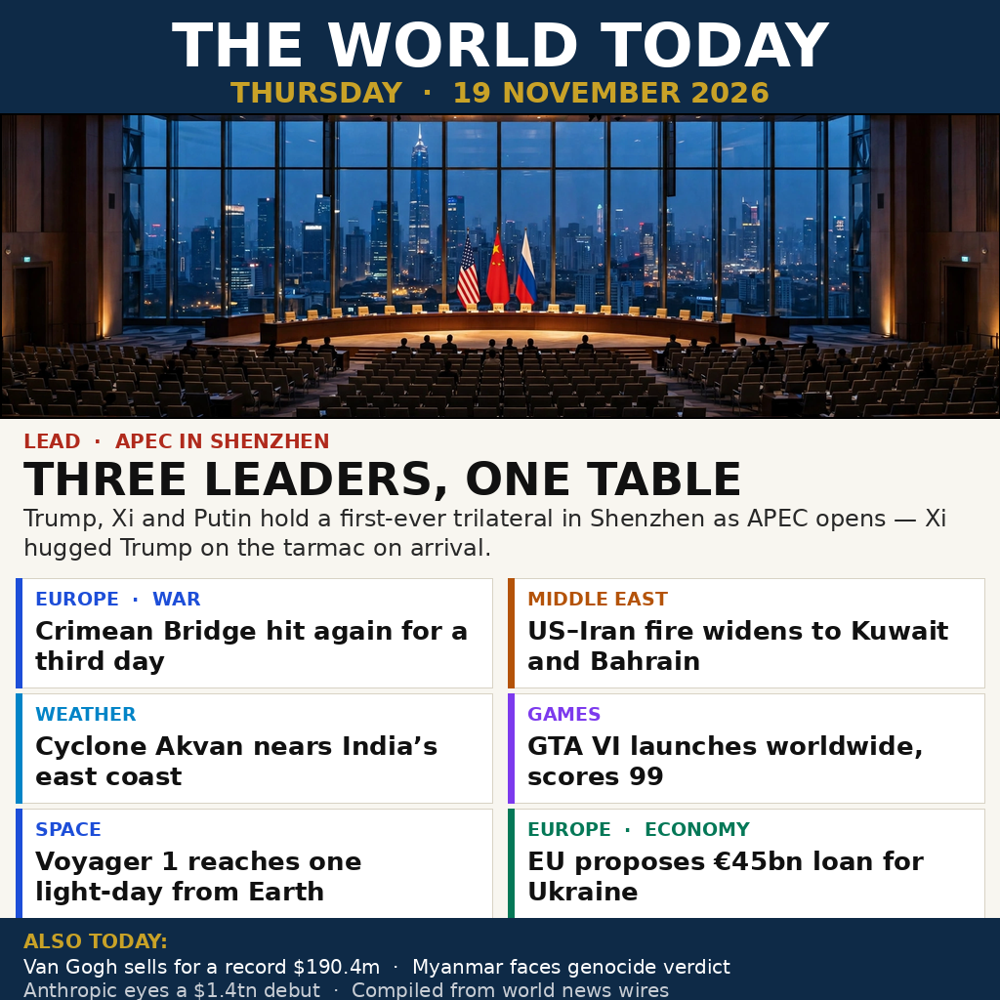

# makefun-news-image-20261119

[](https://make.fun/bounty/news-image-20261119?utm_source=github&utm_medium=readme&utm_campaign=news-image-20261119)
[](https://make.fun/bounty/news-image-20261119/leaderboard?utm_source=github&utm_medium=readme&utm_campaign=news-image-20261119)
[](https://make.fun/bounty/news-image-20261119?utm_source=github&utm_medium=readme&utm_campaign=news-image-20261119)

**THE WORLD TODAY — Thursday 19 November 2026.** One image that sums up
the day's world news as a newspaper front page: the masthead names the day,
the lead story is the first-ever Trump–Xi–Putin trilateral in Shenzhen as
APEC opens (Xi hugged Trump on the tarmac on arrival), and six cards cover
the rest — the Crimea bridge hit again for a third day, US–Iran fire
widening to Kuwait and Bahrain, Cyclone Akvan nearing India's east coast,
GTA VI launching worldwide with a 99 on Metacritic, Voyager 1 reaching one
light-day from Earth, and the EU's proposed €45bn loan for Ukraine. The
footer adds the Van Gogh record sale of $190.4m, the Myanmar genocide
verdict at the UN court, and Anthropic's eye on a $1.4tn debut.

## The image



`entry.png` is 1024×1024, 526,851 bytes. The lead photograph (a summit
conference hall under a dusk skyline, the US, Chinese and Russian flags on
stage) was generated for this entry; every word on the page is drawn with
DejaVu so it stays crisp and legible at any size. All stories were checked
against the day's reporting before the image was drawn.

## Run it

```sh
mkdir -p out && MAKEFUN_OUTPUT_DIR=out python3 main.py
# writes out/entry.png — byte-identical on every run, no network
```

## Files

- `main.py` — the entrypoint: copies `entry.png` to `/output/entry.png`
- `entry.png` — the front page itself
- `LICENSE` — MIT
